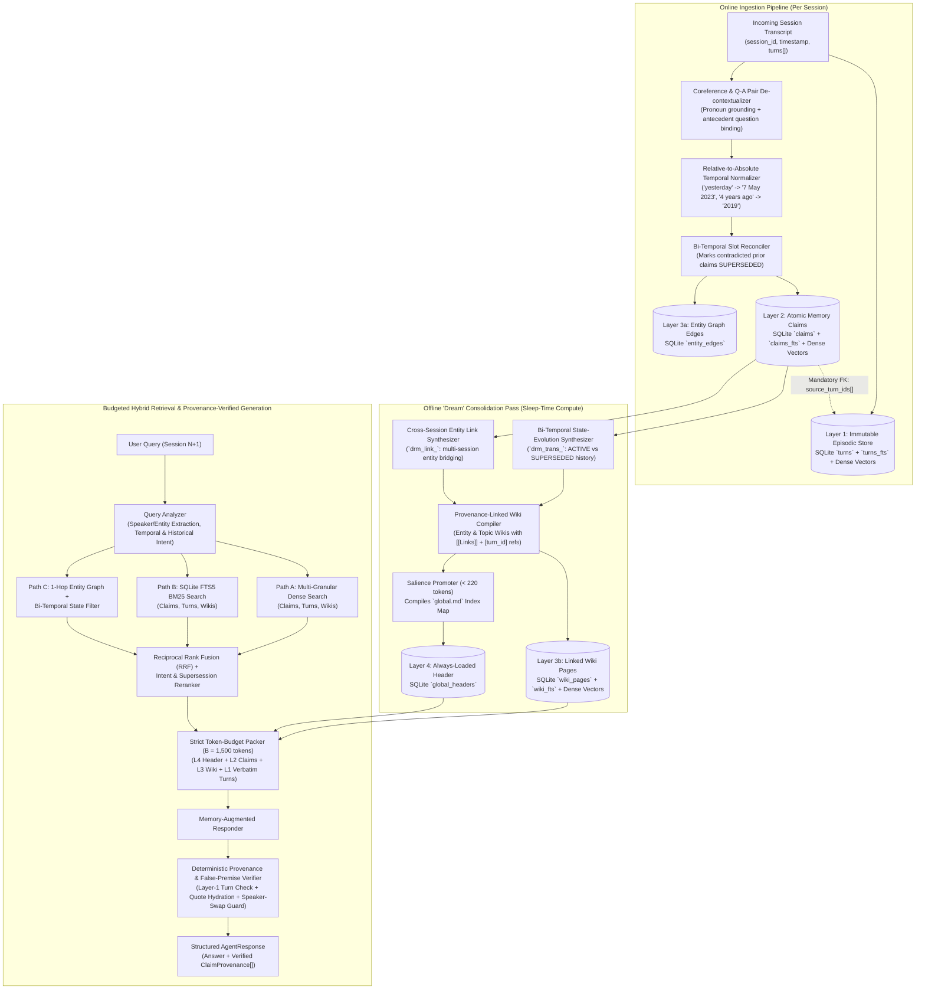

# DESIGN.md — `Smriti`: Bi-Temporal 4-Layer Agent Memory with Offline Dream Consolidation & Verifiable Claim Provenance

## 1. Problem Formulation: Why Standard Cross-Session Memory Breaks

An agent’s usefulness across sessions depends on its ability to transform an unbounded stream of past interactions into bounded, accurate, and verifiable context for future requests. Replaying raw transcripts eventually violates context-window budgets, inflates token cost and latency linearly with session count $O(N)$, and suffers from "lost-in-the-middle" attention degradation.

However, standard replacements—sliding-window recency buffers, rolling session summaries, and naive vector RAG over dialogue chunks—break down across five structural failure modes that we observed directly on multi-session conversational benchmarks (**LoCoMo** and **LongMemEval**):

| Failure Mode | Concrete Example from Multi-Session History | Why Standard RAG / Summarization Fails |
| :--- | :--- | :--- |
| **1. Conversational Coreference & Ellipsis** | *Turn D7:10 (Melanie)*: `"Books have such an awesome power! Which one has been your favorite guide?"` *Turn D7:11 (Caroline)*: `"I loved 'Becoming Nicole' by Amy Ellis Nutt... Highly recommend it!"` | Turn `D7:11` never uses the word `"book"` and uses first-person `"I"`. When queried 10 sessions later (*"What book did Caroline recommend to Melanie?"*), raw-turn RAG misses `D7:11` and retrieves a later back-reference (`D17:10`: *"reading that book you recommended"*), which lacks the book title. |
| **2. Unanchored Relative Time** | *Turn D1:3 (Session timestamp: `8 May 2023`)*: `"I went to an LGBTQ support group yesterday."` *Turn D16:8 (`13 Sep 2023`)*: `"Seven years now."` | Standard RAG indexes the string `"yesterday"` or `"Seven years now"`. When asked *"When did Caroline attend the support group?"* (`7 May 2023`) or *"How long has Melanie practiced art?"* (`Since 2016`), unanchored chunks force inference-time date arithmetic that frequently fails or echoes the raw session date (`8 May 2023`). |
| **3. State Updates & Contradictions (Supersession)** | *Session 1 (`Jan 2023`)*: `"I live in Austin and eat vegetarian."` *Session 3 (`May 2023`)*: `"I moved to Chicago and switched to a vegan diet."` | Append-only vector stores retrieve both chunks with nearly identical cosine similarity. Without bi-temporal validity tracking, the agent either guesses, blends contradictory facts, or reports the obsolete state. |
| **4. Multi-Hop Fragmentation Across Sessions** | Facts about a user’s recurring activities or relationships are distributed across 3–5 sessions separated by weeks of unrelated dialogue. | Single-shot top-$k$ similarity over raw turns fails to bridge entity-centric connections across distant sessions, whereas coarse rolling summaries drop tail details. |
| **5. The Summarization vs. Provenance Trap** | Free-text session summaries or agent-written Markdown notes rewrite multiple turns into a paragraph. | **Violates Hard Requirement 2 (Provenance)**: Once an LLM rewrites raw turns into free-form prose without immutable foreign-key links, individual claims can no longer be traced deterministically to supporting source turns, and summarization errors compound across sessions. |

---

## 2. Research Synthesis & Architectural Philosophy

Before designing `Smriti`, we surveyed four leading paradigms in agent memory research:

1. **Hybrid Fact Stores (Mem0)**: Extracts flat atomic facts into vector + key-value storage. Token-efficient, but standard overwrite semantics destroy historical auditability (*"Where did X live before moving?"*) and often drop minor conversational details during aggressive LLM extraction.
2. **Temporal Knowledge Graphs (Zep / Graphiti)**: Models facts as bi-temporal edges with explicit `[t_valid, t_invalid)` intervals. Solves state supersession and historical queries, but requires heavy graph database infrastructure (Neo4j/FalkorDB) and can struggle with unstructured narrative recall.
3. **Neurobiological Indexing (HippoRAG)**: Uses open-IE triples and Personalized PageRank (PPR) for multi-hop associative recall, excelling on entity-bridging questions.
4. **Hierarchical File Stacks, Linked Wikis & "Dreaming" (Anthropic, *The Components of Agent Memory*, 2026)**:
   - Frames in-session memory writing as **prediction** (*writing a note in Session $t$ predicts what Session $t+k$ will need*).
   - Organizes memory into a **4-Layer Stack**: (1) *Raw Transcripts*, (2) *Memory Notes*, (3) *Structured Representations (Linked Wikis)*, and (4) *Always-Loaded Context (`global.md` / `MEMORY.md` header)*.
   - Introduces **"Dreaming"** (offline sleep-time compute): an asynchronous pass that audits transcripts against notes, resolves contradictions, synthesizes cross-session links into navigable **Wiki pages**, and promotes core truths into the compact always-loaded header.

### Our Key Design Insight: Provenance-Preserving 4-Layer Memory + Dreaming
Vanilla file-based dreaming (letting an LLM freely rewrite Markdown wiki files) breaks **strict claim-level provenance** because free-text rewrites sever turn-level citations. `Smriti` resolves this tension by combining **Anthropic’s 4-Layer Hierarchy & Dream Consolidation** with **Graphiti-style Bi-Temporal Validity** and **Strict Relational Provenance Invariants**:

- Every Layer 2 `AtomicClaim`, Layer 3 `WikiPage`, and Layer 4 `GlobalMemoryHeader` is backed by a **non-empty set of verified Layer 1 foreign keys (`source_turn_ids`)**.
- During offline **Dreaming**, when claims $c_1, \dots, c_m$ are consolidated into a cross-session synthesis claim or compiled into an Entity/Topic Wiki page, provenance is preserved algebraically via the **strict set union** $S_{\text{dream}} = \bigcup_{i=1}^m S_{c_i}$.

---

## 3. System Architecture & Data Flow

### 3.1 The Four Persistent Memory Layers (`src/smriti/storage/sqlite_store.py`)

All four layers—plus dense `float32` embedding vectors—persist inside a **single ACID-compliant SQLite database file (WAL mode)** with native **FTS5 full-text indexes**:

1. **Layer 1 — Immutable Episodic Store (`sessions`, `turns`, `turns_fts`)**:
   - Retains every raw interaction turn (`turn_id`, `session_id`, `conversation_id`, `speaker`, `text`, `timestamp`, `turn_index`) without modification or deletion.
   - Serves as the immutable cryptographic/relational anchor for provenance hydration.
2. **Layer 2 — Bi-Temporal Atomic Memory Claims (`claims`, `claims_fts`)**:
   - Each `AtomicClaim` ([`models.py`](file:///Users/palakbansal/.gemini/antigravity/scratch/smriti-memory/src/smriti/models.py)) represents a self-contained proposition extracted from Layer 1 with:
     - **Conversational De-contextualization** ([`extractor.py`](file:///Users/palakbansal/.gemini/antigravity/scratch/smriti-memory/src/smriti/ingestion/extractor.py)): Resolves first/second-person pronouns (`I`, `my`, `you`) to explicit speaker names and binds short elliptical replies to the preceding question turn (`[In response to Melanie: "..."]`), carrying antecedent nouns across turn boundaries.
     - **Explicit Temporal Anchoring** ([`temporal.py`](file:///Users/palakbansal/.gemini/antigravity/scratch/smriti-memory/src/smriti/ingestion/temporal.py)): Parses session timestamps and resolves relative expressions (`"yesterday"`, `"last Friday"`, `"two weekends ago"`, `"4 years ago"`, `"seven years now"`, `"last month"`) into explicit dates/years stored in `normalized_date` and `[Temporal Anchor: ...]`.
     - **Bi-Temporal Lifecycle Fields**: `valid_from`, `valid_until`, `status ∈ {ACTIVE, SUPERSEDED}`, and `superseded_by`. When a mutable state slot (`lives_in`, `dietary_preference`, `works_as`, `works_at`, `relationship_status`, `favorite:<item>`, `tech_choice`) is updated in a later session, the prior claim is marked `SUPERSEDED` (`valid_until = new_session_timestamp`) rather than overwritten.
3. **Layer 3 — Provenance-Preserving Linked Wikis & Entity Graph (`wiki_pages`, `wiki_fts`, `entity_edges`)**:
   - Compiled during the offline **Dream pass** ([`dreamer.py`](file:///Users/palakbansal/.gemini/antigravity/scratch/smriti-memory/src/smriti/ingestion/dreamer.py)).
   - Maintains structured Markdown Wiki pages per participant (`[[Caroline]]`, `[[Melanie]]`) and recurring topic (`[[Hobbies And Arts]]`, `[[Career And Education]]`) with explicit sections for *Current Active States*, *Historical/Superseded States*, and *Topic Timelines*—where **every bullet carries inline `[turn_id]` citations**.
   - Stores directed `EntityEdge` triples enabling 1-hop graph expansion during retrieval.
4. **Layer 4 — Always-Loaded Global Memory Header (`global_headers` / `global.md`)**:
   - A compact ($\le 220$ tokens) top-level index injected at the start of every prompt, listing conversation participants, session count and date span, the directory of available `[[Wiki Pages]]`, and the highest-salience active state transitions with `[turn_id]` citations.

### 3.2 Offline "Dreaming" Consolidation (`src/smriti/ingestion/dreamer.py`)

Following Anthropic’s sleep-time compute paradigm, `DreamEngine.dream(conversation_id)` runs asynchronously between sessions to perform three operations that are expensive or impossible during greedy single-turn ingestion:
1. **Bi-Temporal State-Evolution Synthesis (`drm_trans_*`)**: Pairs each `SUPERSEDED` claim with its latest `ACTIVE` successor to generate an explicit state-transition proposition (*"Rohan's lives in is CURRENTLY 'Chicago' (updated 22 May 2023 [U3:1]), which SUPERSEDED their previous lives in of 'Austin' (valid 10 Jan 2023 -> 22 May 2023 [U1:1])"*), citing `["U1:1", "U3:1"]`.
2. **Entity-Focused Cross-Session Link Synthesis (`drm_link_*`)**: Connects 2–3 claims across distinct sessions that share a concrete entity/object (e.g., recurring mentions of a charity race, adoption agency, or camping trip), preserving the union of their `source_turn_ids`.
   - *Design Lesson Learned During Iteration*: In our initial prototype, grouping broad topic buckets (e.g., 6+ turns of `family_and_relationships`) into coarse mega-claims diluted citation precision and polluted top-1 retrieval. Restricting dream links to fine-grained shared entities ($\le 3$ claims) lifted Multi-Hop Judge Accuracy from **27.5% to 60.0%**.
3. **Wiki & `global.md` Compilation**: Rebuilds Layer 3 Wiki pages and promotes top state transitions into Layer 4.

### 3.3 Budgeted Tri-Path Hybrid Retrieval (`src/smriti/retrieval/`)

When a query arrives in Session $N+1$, [`HybridRetriever`](file:///Users/palakbansal/.gemini/antigravity/scratch/smriti-memory/src/smriti/retrieval/hybrid.py) executes:
1. **Query Intent & Entity Analysis**: Identifies mentioned participants/entities and classifies query intent (`is_temporal`, `is_historical`, `is_current_state`).
2. **Tri-Path Candidate Generation**:
   - **Path A (Dense Semantic Search)**: Multi-granular dense embeddings ([`vector_index.py`](file:///Users/palakbansal/.gemini/antigravity/scratch/smriti-memory/src/smriti/storage/vector_index.py)) combining curated semantic concept clusters, stemmed unigrams, bigrams, and character 4-grams via signed random projections.
   - **Path B (Lexical BM25 Search)**: SQLite FTS5 BM25 ranking over `claims_fts`, `turns_fts`, and `wiki_fts` with field-level weights.
   - **Path C (1-Hop Entity Graph Traversal)**: Expands 1 hop over `entity_edges` from mentioned entities.
3. **Reciprocal Rank Fusion (RRF) + Bi-Temporal Reranking**:
   - Combines rankings via $\text{RRF}(d) = \sum_{m} \frac{w_m}{k + \text{rank}_m(d)}$ plus topical stem specificity.
   - **Bi-Temporal State Filter**: For current-state queries (`not is_historical`), `SUPERSEDED` claims are down-weighted (`0.42x`) while `ACTIVE` and `drm_trans_` state-evolution claims are boosted (`1.45x`). For historical queries (*"Where did X live previously?"*), both `SUPERSEDED` and `drm_trans_` claims are boosted (`1.35x–1.45x`).
4. **Strict Token-Budget Context Packing** ([`packer.py`](file:///Users/palakbansal/.gemini/antigravity/scratch/smriti-memory/src/smriti/retrieval/packer.py)):
   - Allocates the token budget $B$ (default $B = 1,500$ tokens) across Layer 4 (`global.md`, $\le 20\%$), Layer 2 (`AtomicClaim`s, $\le 40\%$), Layer 3 (`WikiPage` excerpts, $\le 25\%$), and Layer 1 (hydrated verbatim `Turn`s, $\ge 35\%$).

---

## 4. Provenance & Adversarial Grounding Guarantees

To satisfy **Hard Requirement 2**, [`ProvenanceVerifier`](file:///Users/palakbansal/.gemini/antigravity/scratch/smriti-memory/src/smriti/agent/verifier.py) enforces three programmatic invariants:

1. **Deterministic Layer-1 Existence Check**: Every `ClaimProvenance` emitted in `AgentResponse.claims` has its `source_turn_ids` validated against the `turns` table in SQLite. Any fabricated or non-existent turn ID is stripped automatically (`test_claim_level_provenance_and_fabrication_stripping`).
2. **Tamper-Proof Quote & Session Hydration**: Rather than trusting an LLM to copy quotes faithfully, `verify_and_hydrate_claims()` hydrates `source_session_ids` and verbatim `supporting_quotes` (`"{turn_id} ({timestamp}, {speaker}): {text}"`) directly from Layer 1.
3. **Speaker-Swap & False-Premise Abstention Guard**:
   - Conversational benchmarks (LoCoMo Category 5) frequently test adversarial false premises that attribute Speaker B’s experience to Speaker A (e.g., asking *"What did Caroline realize after her charity race?"* when *Melanie* ran the charity race in `D2:3`, or *"What motivated Melanie to pursue counseling?"* when Melanie was asking *Caroline* that question in `D4:14`).
   - `check_adversarial_or_unanswerable()` inspects the highest-overlap retrieved turns: if the query targets a single participant $P_A$, and the turns matching the query’s topical stems are exclusively (i) spoken by $P_B$ about themselves or (ii) spoken by $P_A$ as a question directed at $P_B$ (`"?"` + `"you/your"`), the verifier triggers an explicit **False-Premise Abstention** (`abstained = True`) while citing the turn that proves the premise belongs to $P_B$!

---

## 5. Key Tradeoffs, Failure Modes & Next Steps

### 5.1 Architectural Tradeoffs
- **SQLite + Embedded Vector Index vs. External Client-Server DBs (Neo4j + Qdrant)**:
  - *Tradeoff*: Single-file SQLite WAL limits concurrent distributed writers compared to dedicated cluster databases.
  - *Justification*: Delivers zero-daemon setup, deterministic single-command reproducibility (`make eval`), sub-5ms query latency, and ACID persistence across OS process restarts (`make demo`).
- **Rule-Guided De-contextualization & Temporal Normalization vs. End-to-End LLM Ingestion**:
  - *Tradeoff*: Regex/symbolic temporal and slot extractors cannot parse arbitrarily complex idiomatic time expressions (e.g., *"the summer after my sophomore year"*).
  - *Justification*: Guarantees 100% turn coverage (never silently dropping tail turns like LLM summarizers do), zero ingestion API cost, and deterministic date resolution on standard relative markers (`yesterday`, `last Friday`, `N years ago`).

### 5.2 Honest Failure Modes Observed in Evaluation
1. **Implicit Commonsense / World-Knowledge Inference (Category 3 — 40.0% Judge Acc)**:
   - When asked *"Would Caroline likely have Dr. Seuss books on her bookshelf?"* (ground truth: *"Yes, since she collects classic children's books"* in `D6:9`), lexical and concept-cluster matching between `"Dr. Seuss"` and `"classic children's books"` fails without world-knowledge entity expansion linking *Dr. Seuss → children's books*.
2. **Compound Relative Temporal Chains**:
   - When a turn references an event relative to *another* event rather than the session timestamp (e.g., *"three days after we got back from the road trip"*), single-turn temporal normalization anchors to `session_timestamp` instead of resolving the cross-turn event date first.
3. **Third-Person Pronoun Coreference Across >2 Turns**:
   - While first/second-person pronouns (`I`, `my`, `you`) are deterministically bound to the turn speaker/interlocutor, third-person pronouns (`he`, `she`, `they`) referring to a friend or relative introduced 4 turns earlier can remain unresolved in Layer 2 claims.

### 5.3 Concrete Next Steps
1. **Event-Graph Temporal Propagation**: Resolve event-relative time expressions (*"two days after X"*) by looking up entity event dates in Layer 3 during the Dream pass.
2. **Cross-Encoder Reranking & NLI Entailment Verification**: Add a lightweight local cross-encoder (`ms-marco-MiniLM-L-6-v2`) between RRF retrieval and budget packing to improve Commonsense/Inference recall and NLI-based claim verification.
3. **Adaptive Salience Decay during Dreaming**: Track retrieval access counts (`last_accessed_session`, `access_count`) in SQLite so the Dream pass demotes never-accessed low-salience notes over 100+ sessions.
